# Elspeth Eastman Redesign TDD

## Problem

The redesign keeps the current Django and React application rails while replacing the old content model with a CMS that matches the new site structure. The existing app already has a Django REST Framework backend, token-protected write APIs, a React single-page frontend, modal and toast primitives, CMS-oriented form flows, and the contact email pipeline. Those solved pieces should remain in place unless a specific incompatibility blocks the redesign.

Framework or library modernization is out of scope for this project. React 17, React Router 5, Create React App with CRACO, styled-components, Django, DRF, the current token-auth pattern, and the Heroku-oriented deployment shape continue as the application baseline.

## Existing Application Baseline

This document will take stock of the current application baseline to contextualize the upcoming planned changes.

The backend renders the React SPA through the `Client` view, exposes DRF routes under `/api/`, and serves public content through unauthenticated GET endpoints. CMS writes use a `ProtectCUDWithTokenMixin` class, which permits GET requests and requires `Authorization: Token <token>` for non-GET methods. Tokens older than one day are deleted and rejected with a 403 response.

Current content models:

| Model | Current role | Redesign disposition |
| --- | --- | --- |
| `Contact` | Stores contact-form submissions and email send status. | Retain. |
| `Experience` | Stores year, link, TBA flag, credit, and one of four fixed categories. | Use as a migration source for Voiceover, Music, and Streaming records, then remove from redesigned rendering. |
| `Project` | Stores YouTube source, title, and `uuid`, with `uuid` used as ordering. | Use as a migration or archive source. New sortable records use `sort_order`. |
| `Skills` | Stores three fixed text fields. | Seed relevant page copy, then remove from redesigned rendering. |
| `FooterStat` | Stores numeric footer facts for the old footer. | Retire with the old footer. |
| `Affiliations` | Stores footer affiliation labels and links. | Migrate links that still belong in the redesign, then retire. |

Current API surfaces:

| Endpoint | Current behavior | Redesign disposition |
| --- | --- | --- |
| `/api/experience/` | Returns records grouped by fixed `Experience` category. | Use as a migration source, then remove from redesigned rendering. |
| `/api/contact-me/` | Accepts contact submissions, persists `Contact`, renders email, sends mail, and marks the record sent. | Retain. |
| `/api/footerstats/` | Returns footer stats and affiliations together. | Retire with the old footer. |
| `/api/affiliations/` | Supports affiliation list, create, update, and delete. | Migrate links that still belong in the redesign, then retire. |
| `/api/skills/` | Behaves like a singleton and requires all three fixed fields. | Seed relevant page copy, then retire. |
| `/api/projects/list/` | Lists projects by descending `uuid` and supports batch update. | Use as a migration or archive source. New sortable records use dedicated endpoints and `sort_order`. |
| `/api/projects/paginated/` | Returns paginated projects with `page` as a required query parameter. | Retire with the old `/projects` public UX. |
| `POST /api/session/` | Validates the token and refreshes the token timestamp. | Retain. |
| `POST /api/session/login/` | Uses DRF authtoken login. | Retain. |
| `POST /api/session/logout/` | Deletes the current token. | Retain. |

The frontend currently renders `/`, `/projects`, `/cms`, and `/login`. The CMS frontend is guarded by `PrivateRoute`, a React Router wrapper retained in the target frontend architecture. Backend write authorization still comes from the API layer.

The current CMS itself is a separate composition of `EditableSkills`, `EditableProjects`, `EditableExperience`, and `EditablePageFooter` components. The hero and music sections appear in the current CMS as read-only content through a `DisabledSectionContainer` component. The redesign should replace that separate CMS composition with shared page components that render in public mode and CMS mode.

Existing frontend pieces worth preserving include:

1. the modal component
2. toast manager
3. form inputs (minus presentational layer)
4. API helper concepts
5. destructive action confirmation,
6. session token injection and expired-session handling
7. create, update, and delete patterns in the existing editable components

Existing CMS write flows currently move through small API helper functions, which call `requestOptionsFactory` to add the CSRF header, JSON content type, and token authorization when credentials are required. Media upload support for the redesign will require a request-helper option that lets `FormData` requests omit the JSON content type so the browser can set the multipart boundary.

The current settings use WhiteNoise for compiled static assets in production and `django_heroku` when `HEROKU` is enabled. The app has no CMS-managed media system today: no `ImageField`, no `FileField`, no `MEDIA_URL`, no `MEDIA_ROOT`, no storage backend configuration for uploaded media, and no upload API. Persisted uploaded media is the largest new infrastructure capability in this redesign.

## Redesign Strategy

The redesign keeps the application's working rails and adds the capabilities required by the new page structure. The target state is a page-oriented site in which public visitors and CMS editors use the same React page components, content is stored in models that reflect the redesigned pages, and editors can manage text, collections, and uploaded media through consistent APIs.

The work divides into five capability gaps:

| # | Existing limitation | Planned remediation | Result |
| --- | --- | --- | --- |
| 1 | Public pages and CMS screens use separate component compositions. | Render each page through one shared component tree, with CMS behavior supplied through context. | Public and CMS views cannot drift structurally. |
| 2 | Existing models describe the old site's information architecture rather than the redesigned pages. | Introduce stable page identities, shared content primitives, and page-specific domain models. | The data model follows visible page content and editing needs. |
| 3 | The application cannot accept or retain CMS-managed uploads. | Add validated media records, multipart upload support, and external storage. | Editors can replace page imagery without a deployment. |
| 4 | Fixed copy, image slots, and singleton records have no deterministic initialization mechanism. | Define a seed registry and create required records through migrations. | Application code and database content agree on the records that must exist. |
| 5 | Existing editing and ordering behavior is tied to individual legacy components and models. | Standardize API authorization, collection ordering, and reusable CMS controls. | New page sections share predictable editing behavior. |

These capabilities are established once and then applied through the page specifications that follow. Each page specification is a vertical slice: it describes the experience first, then the data model and API needed to support it.

### One Page Tree for Public and CMS Rendering

**Problem.** The current public site and CMS use separate component compositions. Some public sections are represented in the CMS only as disabled previews, so a redesign implemented in both trees could drift in structure or behavior.

**Solution.** Each redesigned page should have one shared component tree. Public routes render it without editing behavior; mirrored CMS routes render it inside the authenticated CMS shell with editing behavior supplied through context.

The target route set is:

Public content routes:

```text
/
/voiceover
/music
/streaming
/press
/bio
```

CMS routes mirror the public routes:

```text
/cms
/cms/voiceover
/cms/music
/cms/streaming
/cms/press
/cms/bio
```

`/cms` renders the Home page in CMS mode. CMS navigation preserves the `/cms` prefix, so an editor on `/cms/music` who clicks Voiceover lands on `/cms/voiceover`. Public navigation uses the public path.

`/login` remains a support route. The redesigned public navigation omits `/projects`.

#### Component Architecture

The current provider stack already gives the app routing, theme, toast, and auth context. The redesign should keep that stack and route public and CMS traffic into the same page components. Below is the target application architecture.

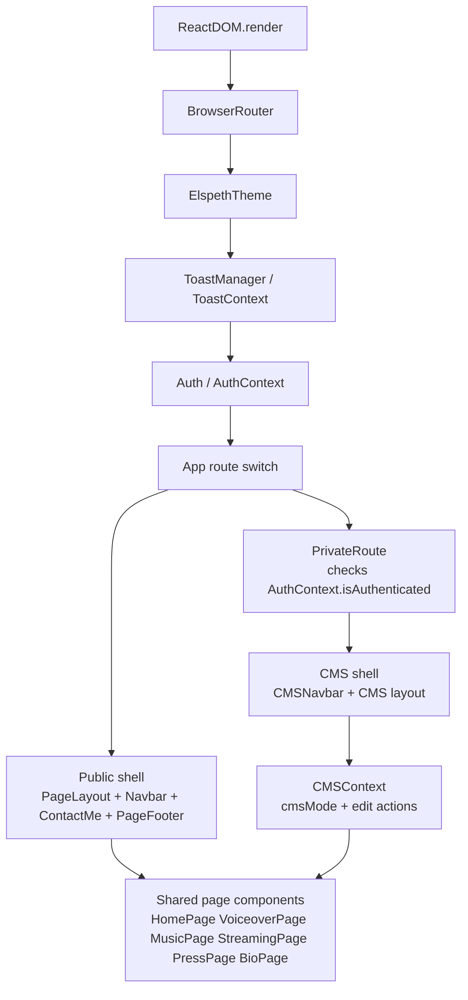

`PrivateRoute` is a frontend guard for the CMS shell. Backend write authorization still comes from the API token checks described in the existing application baseline.

`CMSContext` should carry CMS mode and editing actions so nested sections can render edit controls without receiving a `cmsMode` prop through every intermediate component. Public routes render the shared pages without that editing context.

## Shared Implementation Contracts

Design reference: [component board](https://www.figma.com/design/viiamFWKh3yqWHBfl1PJA3/Elspeth-Eastman-Redesign?node-id=8-116).

The shared page tree above gives visitors and editors the same view of the site. The next step is to give that tree a consistent way to load content and save changes. We will follow that path from a visitor opening a URL to an editor changing what appears there, then apply it to each page. The endpoints and Django classes below are proposed contracts for that implementation; existing authentication and contact behavior stays in place.

### Identity, Content, and API

Start with a visitor opening a page. The URL tells the application where they want to go, but it should not become the permanent identity of the content stored there. A `Page` therefore has an immutable database ID, an editable title and slug, and a stable `kind` that selects its React renderer. On startup, `GET /api/site/` supplies the page registry. The application resolves the current slug to an ID, then loads that page through `GET /api/pages/{page_id}/`. Renaming a page changes its address and navigation label without changing its content API address. Its title also supplies a fallback heading when no explicit headline block is present.

Navigation follows the same separation. Frontend code chooses destinations and their order by `PageKind`; `pageHref(kind)` resolves the current slug and adds the CMS prefix when appropriate. In-page actions such as Music's `#releases` are also code-defined, so neither needs a persisted link collection or editing controls. For these URLs to work on a fresh browser load, Django must serve the SPA at registered public and CMS paths while keeping `/api/` and reserved routes separate.

Once the application has found the page, it needs content it can place in the layout. Copy is an ordered collection of blocks: `(page_id, key)` identifies a block, while `section` and `kind` tell the renderer where and how to display it. This lets an editor add another introduction paragraph or subheadline without needing a new endpoint or a migration for each key.

That flexibility stays within the designed page. Each renderer supports an allowlist of sections and text treatments; adding a new layout region still requires frontend work. Within those regions, the CMS can add, edit, remove, and reorder blocks. Missing optional blocks render nothing, and all copy remains plain text.

The diagram below puts `Page` at the center of that arrangement. Copy, image slots, identity labels (`Breadcrumb`), facts (`TriviaItem`), and larger content entries belong to a page. Image files live separately as reusable `MediaAsset` records, allowing a page or entry to replace its artwork without changing its own identity.

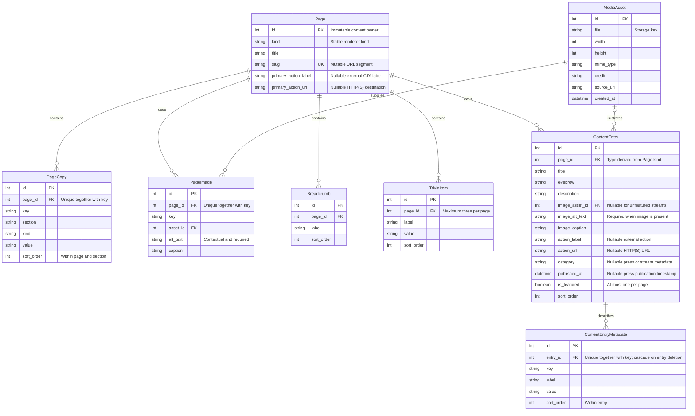

Read the ownership relationships as a guide to where an edit belongs. A role, press item, or recent stream is a `ContentEntry`; its owning `Page.kind` determines the relevant field rules (see the per-kind validation table in [Content Entries, Promotion, and Media](#content-entries-promotion-and-media) below). The page-specific records introduced later—[Music's feature and releases](#music-page), [Streaming's clips](#streaming-page), [Press's appearances](#press-page), and [Bio's chapters and current-work items](#bio-page)—also reference their owning `Page` through `page_id`. Where a record includes an image, it refers to a reusable `MediaAsset` file while retaining contextual alt text for that use. For standalone copy and image slots, a unique `(page_id, key)` constraint keeps each address unambiguous.

Links follow their content owner too. The reel and Twitch intro actions are label/URL fields on `Page`, exposed as `primary_action`; setting that value to null clears both fields. A listen, watch, or article action belongs to its content record. These editable external destinations do not need a separate link endpoint.

This ownership model gives the API two complementary jobs. A page read returns the content needed to render the whole page—its “aggregate” response—while an editor saves only the resource they changed. The shared endpoints below establish that pattern; the page sections add the collection-specific contracts.

| Full endpoint | Input | Success response |
| --- | --- | --- |
| `GET /api/site/` | None | `200 SiteResponse` |
| `GET /api/pages/{page_id}/` | Immutable ID in path | `200` page-specific response below |
| `PATCH /api/pages/{page_id}/` | `PageMetadataInput` | `200 PageDescriptor` |
| `POST /api/copy/` | `CopyWrite` | `201 CopyBlock` |
| `PATCH /api/copy/` | `CopyPatch`, addressed by page ID and key | `200 CopyBlock` |
| `DELETE /api/copy/?page_id={page_id}&key={key}` | `KeyedScope` in query | `204`, no body |
| `PATCH /api/page-images/` | `PageImageWrite` | `200 PageImage` |
| `POST /api/eyebrows/` | `EyebrowInput` | `201 Eyebrow` |
| `PATCH /api/eyebrows/{id}/` | `Partial<Omit<EyebrowInput, "page_id">>` | `200 Eyebrow` |
| `DELETE /api/eyebrows/{id}/` | None | `204`, no body |
| `POST /api/trivia/` | `TriviaInput` | `201 Trivia` |
| `PATCH /api/trivia/{id}/` | `Partial<Omit<TriviaInput, "page_id">>` | `200 Trivia` |
| `DELETE /api/trivia/{id}/` | None | `204`, no body |
| `PATCH /api/collections/reorder/` | `ReorderInput` | `200 ReorderOutput` |
| `PATCH /api/featured-items/` | `FeatureInput` | `200 FeatureState` |
| `POST /api/media-assets/` | Multipart `MediaUpload` | `201 MediaAsset` |

For the reader, the aggregate means the page does not have to fetch its copy, images, and collections one at a time. For the editor, it means saving a paragraph does not require resubmitting the entire page. POST creates a record, PATCH changes an existing one, and DELETE sends no request body; keyed DELETE addresses travel in query parameters. A missing update target returns 404 rather than being silently created. Seeded image slots can only be patched, while copy blocks can grow or shrink through the CMS.

Collections keep a manual `sort_order`, matching the curated presentation in the designs; date-order controls are outside this scope. A record also keeps its original owner. Domain serializers check that the page has a compatible renderer kind and reject ownership changes. Operations that affect other records, such as choosing a featured item, have their own path rather than exposing `is_featured` as an ordinary editable field.

The public/CMS distinction matters when a request changes data. Anyone can read content, but content writes retain the existing token check and return `403` when it fails. The public contact form remains the exception. Validation and lookup failures return `400 ApiError` and `404 ApiError`, respectively, so the editor can distinguish invalid input from a missing record.

The request helper must carry those distinctions back to React. It should preserve error statuses, accept all successful 2xx responses, and skip JSON parsing for a bodyless `204`. The existing assumptions of `200` success and a JSON body cannot cover the new create/delete flows.

The interfaces below describe the data crossing that boundary. Start with page identity and keyed content, then follow the image/link values into the collections and aggregate response. They use TypeScript to make the contract explicit, not to require a frontend language migration; derived interfaces inherit the documented properties of their bases.

```ts
/** Immutable database identity; never derived from a page title or URL. */
type PageId = number;

/** Supported renderers; renaming a page does not change its layout kind. */
type PageKind = "home" | "voiceover" | "music" | "streaming" | "press" | "bio";

/** Page registry record used to resolve navigation and choose a React page. */
interface PageDescriptor {
  /** Stable primary key referenced by all content records. */
  id: PageId;
  /** Renderer selected by application code; read-only in the CMS. */
  kind: PageKind;
  /** Editable page heading and navigation label. */
  title: string;
  /** Current public path segment; empty only for the home page. */
  slug: string;
  /**
   * First used by Voiceover's introductory demo-reel button: the CMS editor can
   * change its label and external reel destination without editing a role.
   * Streaming later uses the same field for its introductory Twitch link.
   * Null when absent or when the renderer uses a code-defined internal action.
   */
  primary_action: LinkValue | null;
}

/** Public registry returned once on application startup. */
interface SiteResponse {
  /** All routable pages; frontend code chooses navigation destinations and order. */
  pages: PageDescriptor[];
}

/** Partial update for page metadata and its optional external intro CTA. */
interface PageMetadataInput {
  /** New nonempty heading and navigation label. */
  title?: string;
  /** New unique path segment; reserved routes and the home slug are protected. */
  slug?: string;
  /** Replace the external CTA label/URL together, clear with null, or omit to leave unchanged. */
  primary_action?: LinkInput | null;
}

/** Owner identity supplied in request bodies or query parameters. */
interface PageScope {
  /** Existing page that owns the resource; ownership cannot change on update. */
  page_id: PageId;
}

/** Stable address for a page content record. */
interface KeyedScope extends PageScope {
  /** Opaque content key unique within this page and resource type; independent of display text. */
  key: string;
}

/** Creation payload for one ordered plain-text block. */
interface CopyWrite extends KeyedScope {
  /** Layout region, such as intro or short_bio; validated against the page renderer. */
  section: string;
  /** Semantic treatment; renderers support multiple blocks of each allowed kind. */
  kind: "headline" | "subheadline" | "body" | "section_label";
  /** Plain text rendered as text; never interpreted as HTML or Markdown. */
  value: string;
}

/** Update by key; omitted fields retain their existing values. */
interface CopyPatch extends KeyedScope {
  /** Replacement plain text. */
  value?: string;
  /** Replacement semantic treatment within the current section. */
  kind?: CopyWrite["kind"];
}

/** Stored copy returned by reads, creates, and updates. */
interface CopyBlock extends CopyWrite {
  /** Database identity used in reorder payloads. */
  id: number;
  /** Position within the page and section. */
  sort_order: number;
}

/** Multipart payload accepted by the authenticated upload endpoint. */
interface MediaUpload {
  /** JPEG, PNG, or WebP binary; sent through FormData. */
  file: File;
  /** Optional attribution for the source asset. */
  credit?: string;
  /** Optional original source URL. */
  source_url?: string;
}

/** Stored asset metadata; contextual alt text is supplied by each use. */
interface MediaAsset {
  /** Asset primary key used when attaching the upload. */
  id: number;
  /** Public storage URL for browser rendering. */
  url: string;
  /** Decoded image width in pixels. */
  width: number;
  /** Decoded image height in pixels. */
  height: number;
  /** Server-verified image format. */
  mime_type: "image/jpeg" | "image/png" | "image/webp";
  /** Attribution; empty when none is provided. */
  credit: string;
  /** Original source URL; empty when unknown. */
  source_url: string;
  /** ISO 8601 upload timestamp. */
  created_at: string;
}

/** Image attachment or replacement submitted with a content mutation. */
interface ImageUseInput {
  /** ID of an existing successfully uploaded asset. */
  asset_id: number;
  /** Required description for this particular use of the image. */
  alt_text: string;
  /** Optional visible caption represented by an empty string when unused. */
  caption: string;
}

/** Image attachment returned with expanded asset metadata. */
interface ImageUse extends Omit<ImageUseInput, "asset_id"> {
  /** Resolved asset for rendering; replaces the write-only asset_id field. */
  asset: MediaAsset;
}

/** Keyed image-slot mutation, including replacement or alt-text-only edits. */
interface PageImageWrite extends KeyedScope {
  /** Attachment to persist under the supplied page and key. */
  image: ImageUseInput;
}

/** Stored standalone image slot used by Home and Bio. */
interface PageImage extends KeyedScope {
  /** Resolved image and contextual metadata. */
  image: ImageUse;
}

/** Editable external destination stored on its owning page or domain record. */
interface LinkInput {
  /** Visible action text. */
  label: string;
  /** Absolute HTTP(S) destination; intra-site paths and fragments are code-defined. */
  url: string;
}

/** Render-ready action, derived from stored external fields or frontend route configuration. */
interface LinkValue {
  /** Visible action text. */
  label: string;
  /** External URL, resolved internal route, or code-defined fragment. */
  href: string;
  /** True for stored external actions; false for code-defined intra-site actions. */
  is_external: boolean;
}

/** Create payload for a label in the page identity strip. */
interface EyebrowInput extends PageScope {
  /** Visible label; names may change without changing record identity. */
  label: string;
}

/** Create payload for a label/value fact. */
interface TriviaInput extends PageScope {
  /** Short fact heading. */
  label: string;
  /** Displayed fact value. */
  value: string;
}

/** Read-only collection metadata assigned by the server. */
interface OrderedRecord {
  /** Primary key used for update, deletion, and selection. */
  id: number;
  /** Manual position within the owning collection. */
  sort_order: number;
}

/** Persisted identity-strip label. */
interface Eyebrow extends EyebrowInput, OrderedRecord {}

/** Persisted fact; each page may contain at most three. */
interface Trivia extends TriviaInput, OrderedRecord {}

/** One display fact submitted within its owning entry's metadata collection. */
interface ContentEntryMetadataInput {
  /** Stable key unique within the entry; identifies an existing row on replacement. */
  key: string;
  /** Nonempty plain-text display label, such as Publication. */
  label: string;
  /** Nonempty plain-text display value, such as the publication name. */
  value: string;
}

/** Stored display fact; identity and order are assigned by the server. */
interface ContentEntryMetadata extends ContentEntryMetadataInput, OrderedRecord {
  /** Owning entry; set by the parent write and never accepted from the metadata payload. */
  entry_id: number;
}

/** Create a role, press item, or recent stream; Page.kind selects validation and editor labels. */
interface ContentEntryInput extends PageScope {
  /** Main card title; labeled Character on Voiceover. */
  title: string;
  /** Franchise on Voiceover, format on Press, or game/context on Streaming. */
  eyebrow: string;
  /** Plain-text summary shared by the card, hero, and any selected detail. */
  description: string;
  /** Artwork and contextual alt text; null is allowed only for an unfeatured stream. */
  image: ImageUseInput | null;
  /** External project/read/watch action; null is allowed only for Voiceover. */
  action: LinkInput | null;
  /** Optional card metadata for Press or Streaming; null for Voiceover. */
  category: string | null;
  /** Optional Press publication datetime in ISO 8601 with a timezone, e.g. 2026-10-01T14:30:00Z; null on other page kinds. */
  published_at: string | null;
  /** Complete ordered display facts; array order sets sort_order. Press requires an outlet key. */
  metadata: ContentEntryMetadataInput[];
}

/** Persisted entry shared by the card, hero, and detail; no independent kind field. */
interface ContentEntry extends Omit<ContentEntryInput, "image" | "action" | "metadata">, OrderedRecord {
  /** Expanded artwork; null only for an unfeatured stream. */
  image: ImageUse | null;
  /** Resolved external action; null when a role has no project link. */
  action: LinkValue | null;
  /** Persisted display facts in sort_order, shared by card, hero, and detail presentations. */
  metadata: ContentEntryMetadata[];
  /** Read-only hero flag, changed only through the promotion endpoint. */
  is_featured: boolean;
}

/** Atomic replacement of one collection's complete order. */
interface ReorderInput extends PageScope {
  /** Server allowlist selects the model; arbitrary model names are rejected. */
  collection: "copy" | "eyebrows" | "trivia" | "content_entries" | "releases" | "stream_clips" | "appearances" | "bio_chapters" | "current_items";
  /** Required for copy; null for the other collection types. */
  section: string | null;
  /** Every current member exactly once, including an entry shown as the hero. */
  ordered_ids: number[];
}

/** Canonical collection scope and order after a successful reorder. */
interface ReorderOutput extends ReorderInput {}

/** Promote an existing item or explicitly clear the hero. */
interface FeatureInput extends PageScope {
  /** Existing member to promote; null demotes the current hero. */
  item_id: number | null;
}

/** Canonical hero selection; the client derives its display from the same collection. */
interface FeatureState extends FeatureInput {}

/** Shared portion of every aggregate page response. */
interface PageContent {
  /** Stable identity plus current display and route metadata. */
  page: PageDescriptor;
  /** Blocks ordered within each section; render by section and kind, not key names. */
  copy: CopyBlock[];
  /** Standalone image slots; domain card images live on their own records. */
  images: PageImage[];
  /** Identity strip in manual order. */
  eyebrows: Eyebrow[];
  /** Up to three facts in manual order. */
  trivia: Trivia[];
}

/** Normalized error envelope for the new content endpoints. */
interface ApiError {
  /** Human-readable failure description. */
  detail: string;
  /** Field-specific serializer errors, including non_field_errors when applicable. */
  fields?: Record<string, string[]>;
}
```

For example, suppose an editor changes the second paragraph in a page's introduction. The request identifies the existing block independently of the page's current title or slug:

```json
{
  "page_id": 42,
  "key": "intro-paragraph-2",
  "value": "An additional paragraph about the work."
}
```

Sending this body to `PATCH /api/copy/` changes that paragraph. Adding it for the first time instead uses `POST /api/copy/`, with `section: "intro"` and `kind: "body"` added to the same identity and text. New blocks append to the section; the editor can then submit its complete order through `PATCH /api/collections/reorder/`. The endpoint stays the same as the introduction grows.

Reordering is a collection operation, so it needs a consistent view of the collection. Lock the owning `Page` inside `transaction.atomic()`, then reject duplicate, missing, or foreign IDs before saving any positions. Creation, deletion, and promotion take the same lock. That coordination prevents a concurrent edit from changing membership underneath a reorder or allowing two creates to exceed the three-fact limit.

### Content Entries, Promotion, and Media

The role cards on [Voiceover](#voiceover-page), article and interview cards on [Press](#press-page), and recent-stream cards on [Streaming](#streaming-page) build on the same ownership and ordering rules as the copy blocks above. Each card presents a piece of work rather than a standalone paragraph. Their labels differ, but editors manage them in the same way: create an entry, supply its content and artwork, place it in order, and optionally feature it as the page's hero—the prominent card at the top of the page. Choosing an existing entry for that featured position is called **promotion**. They therefore share `ContentEntry` and `ContentEntrySerializer`.

Their common write surface is `POST /api/content-entries/` and `PATCH/DELETE /api/content-entries/{id}/`. Creation accepts `ContentEntryInput` and returns `201 ContentEntry`; PATCH accepts `Partial<Omit<ContentEntryInput, "page_id">>` and returns `200 ContentEntry`; deletion returns `204`. Reads stay in the owning page's aggregate. Reordering identifies that page and uses `collection: "content_entries"` with `section: null`.

Sharing storage does not make every field meaningful on every page. `ContentEntrySerializer` resolves the owner and accepts only the `voiceover`, `press`, and `streaming` kinds. Both ownership and `Page.kind` are immutable, so changing a page's name cannot change what its entries mean. The CMS uses familiar labels such as Character or Outlet, while the serializer applies the corresponding rules below. For PATCH, those rules apply to the existing record merged with the submitted changes.

| Owning page kind | Field meanings and validation |
| --- | --- |
| `voiceover` | <ol><li><code>title</code> is Character, <code>eyebrow</code> is Franchise, and <code>description</code> is Summary.</li><li>Image is required; action is optional.</li><li>The detail label/value becomes an optional metadata row with key <code>details</code>; metadata may be empty.</li><li>Category and <code>published_at</code> must be null.</li></ol> |
| `press` | <ol><li><code>eyebrow</code> is Format (Interview, Podcast, Feature), not another type discriminator.</li><li>Image and action are required.</li><li>A metadata row keyed <code>outlet</code> is required for the publication/channel.</li><li><code>published_at</code> and category may be null.</li></ol> |
| `streaming` | <ol><li><code>eyebrow</code> is Game/context.</li><li>Action is required; image is optional until promotion.</li><li>Category may be null; <code>published_at</code> must be null.</li><li>Metadata may be empty.</li></ol> |

Across all three kinds, title, eyebrow, and description must be nonempty. A create submits the complete input shape, using null for unused nullable fields and an array for metadata; a PATCH leaves unchanged fields out. Fields that do not apply to the owning page kind are rejected when non-null.

Supplementary display facts belong to the entry without becoming columns for every possible page. `ContentEntryMetadata` stores each fact as an ordered key/label/value row, unique on `(entry_id, key)`. For example, Press can store `outlet / Publication / Polygon`, while Voiceover can store its existing detail heading and text under `details`. The page-specific editor supplies appropriate defaults and checks required keys; additional display facts use the same shape. Every key, label, and value must be nonempty, and labels and values remain plain text. Rendering uses stable keys for named fields such as the outlet and `sort_order` for supplementary rows, so changing a visible label does not change its meaning. These are related records with an explicit schema, not an unstructured JSON field.

Editors manage these rows inside the entry form, including their order. The existing entry POST/PATCH accepts the nested `metadata` array; it does not need separate metadata endpoints or a new reorder scope. On PATCH, omitting `metadata` leaves the rows unchanged, while supplying it replaces the complete collection. An empty array clears optional facts but fails validation for Press because its outlet is required. The server matches rows by key within that entry, preserves IDs for retained keys, deletes omitted rows, and assigns `sort_order` from array position. It derives ownership from the parent and accepts no row IDs or `entry_id` in the nested input.

Implement the nested write explicitly in `ContentEntrySerializer.create()` and `update()`, using a nested metadata serializer for row validation. Validate duplicate keys and the page's required facts before saving, then commit the entry and its rows in one transaction under the shared page lock; a failed row must roll back the whole save. Deleting the entry cascades to its metadata. Page reads prefetch the ordered rows, and successful entry writes return the same canonical nested collection, so the card, hero, and detail stay in sync.

Press publication time follows the same separation between stored content and presentation. `published_at` is a nullable Django `DateTimeField`; the API accepts ISO 8601 datetimes with an explicit timezone and returns them normalized to UTC. The frontend can display just the year today or a fuller date later without changing the stored value. Unknown publication datetimes remain null rather than being invented from a year-only source. Collection ordering remains manual.

This is the extent of the consolidation. Pages retain their own layouts and CMS labels while sharing entry CRUD, ordering, media, and promotion. Clips, appearances, and Music's feature and releases keep their separate contracts, which we will encounter in the page walkthroughs.

Promotion changes where an entry appears, not what record stores it. For example, an editor can select a recent stream to appear as the Streaming page's hero instead of as a card in the list below. The editor sends `page_id` and `item_id` to `PATCH /api/featured-items/`; `FeatureSerializer` checks the page kind and confirms that the entry belongs to it. The transaction service then locks the page, rechecks membership and image eligibility, clears the old feature flag, and selects the new entry. A conditional unique constraint on `ContentEntry.page_id` where `is_featured=True` enforces at most one hero per page. Ordinary updates that could affect eligibility take the same lock.

The frontend can now derive both presentations from one response: the complete collection plus `FeatureState`. Visitors see the selected entry as the hero and the remaining entries below it. Editors still see every entry in the CMS collection, with the selected one marked. Editing the hero therefore updates the same record as editing its card.

Promoting an entry to the hero does not change its stored `sort_order`. **Demotion** means removing that featured status, which returns the entry to the regular list at its stored position. Clearing the selection or deleting the selected entry leaves no hero; the system does not choose a replacement. After any of these writes, the client reconciles the selected ID and the affected feature flags together.

Streaming illustrates why eligibility is checked separately from ordinary list editing. A stream can exist in the list without an image, but it needs one to become the hero. Promotion without an image returns a field error; removing the image from an already featured stream is also rejected. The other prominent panels do not all follow this pattern: Music's cello feature is specialized, and Home's portrait and Bio's short biography are authored introductions rather than selections from a collection.

An image replacement adds one step before the content save. The editor first uploads the file to `MediaAssetCreateAPIView`, which uses DRF's `MultiPartParser` and `MediaAssetSerializer`. The upload verifies JPEG/PNG/WebP decoding and MIME type, enforces a configurable size limit of 10 MiB by default, and writes the file through Django's storage backend. SVG is excluded. The resulting asset ID is then attached in the content edit, where contextual alt text is validated. Cancelling after upload may leave an unattached asset for later cleanup; it does not replace the image currently in use.

The saved reference must still point to a usable file after deployment. Local filesystem storage is acceptable in development; staging and production require persistent object storage configured with a backend, bucket, region, endpoint where applicable, credentials, and public media URL. Missing production configuration must fail deployment checks. Choose storage-package versions against the deployed Django version during implementation, since the repository's unpinned requirements do not establish that version.

### Frontend and Django Responsibilities

With the data contract in place, we can follow it through the application. The route controller resolves a page ID from `SiteResponse`, fetches the aggregate, and supplies it to the page component. Public and CMS routes mount that same component; `CMSContext` adds mutation callbacks and makes editing controls available only in CMS mode. Content components receive data and callbacks rather than constructing API URLs. The six initial routes remain as listed above, with code-defined navigation resolving current labels and URLs from the registry.

The five content pages other than Home—Voiceover, Music, Streaming, Press, and Bio—are referred to here as **interior pages**. Each begins with `PageIntro`: the `intro` copy blocks, identity strip, facts, and optional action. Home instead uses its own `HomeHero` introduction. Across the page tree, text, image, link, and collection editors use the shared contracts below. This is the division to preserve as pages are built: common editors own the repeated editing interaction, while page-specific props describe interactions such as selecting a role or promoting a stream.

```ts
/** Rendering mode established by the public or authenticated CMS shell. */
type PageMode = "public" | "cms";

/** Inputs supplied by the route controller to each shared page. */
interface PageProps<TData> {
  /** Loaded aggregate response; the route controller handles loading, failure, and retry. */
  data: TData;
}

/** Shared CMS collection contract; public presentation reads items only. */
interface CollectionEditorProps<TInput, TItem> {
  /** Canonical records in current manual order. */
  items: TItem[];
  /** Open/save a new record and append the server result. */
  onCreate(input: TInput): Promise<TItem>;
  /** Save changed fields and replace the matching local record. */
  onUpdate(id: number, input: Partial<TInput>): Promise<TItem>;
  /** Confirm deletion and remove the record only after success. */
  onDelete(id: number): Promise<void>;
  /** Submit the complete order; restore the previous order on failure. */
  onReorder(orderedIds: number[]): Promise<void>;
}

/** Shared editor used by introductory and section text blocks. */
interface CopyEditorProps {
  /** Blocks for the displayed section in manual order. */
  blocks: CopyBlock[];
  /** Create a block with an editor-generated stable key. */
  onCreate(input: CopyWrite): Promise<CopyBlock>;
  /** Save by page ID and key without assuming a headline or body endpoint. */
  onSave(input: CopyPatch): Promise<CopyBlock>;
  /** Remove a block after confirmation; its key is sent as a query parameter. */
  onDelete(address: KeyedScope): Promise<void>;
  /** Reorder all blocks in the addressed section. */
  onReorder(input: ReorderInput): Promise<void>;
}

/** Image editor shared by standalone slots and domain records. */
interface ImageEditorProps {
  /** Current attachment; null when an optional card image is absent. */
  image: ImageUse | null;
  /** Upload and return an unattached asset; does not save the page record. */
  onUpload(input: MediaUpload): Promise<MediaAsset>;
  /** Attach the chosen asset and contextual metadata to the owning resource. */
  onSave(input: ImageUseInput): Promise<void>;
}

/** Editor for external CTA fields on a page or domain record; not used for intra-site links. */
interface LinkEditorProps {
  /** Current destination and visible action label. */
  link: LinkValue;
  /** Persist the external destination through the owning page or domain endpoint. */
  onSave(input: LinkInput): Promise<void>;
}

/** Shared interior introduction, driven by collections and CMSContext. */
interface PageIntroProps {
  /** Current heading and route metadata. */
  page: PageDescriptor;
  /** Ordered intro text; multiple body and subheadline blocks are supported. */
  blocks: CopyBlock[];
  /** Ordered identity labels. */
  eyebrows: Eyebrow[];
  /** Ordered label/value facts. */
  trivia: Trivia[];
  /** Stored external CTA or code-defined internal action; null when absent. */
  action: LinkValue | null;
}

/** Editing services supplied at the CMS route boundary. */
interface CMSContextValue {
  /** Controls visibility of editing affordances; never grants backend permission. */
  mode: PageMode;
  /** Bound copy callbacks for the loaded page. */
  copy: CopyEditorProps;
  /** Identity-strip callbacks bound to the current page ID. */
  eyebrows: CollectionEditorProps<Omit<EyebrowInput, "page_id">, Eyebrow>;
  /** Fact callbacks bound to the current page ID. */
  trivia: CollectionEditorProps<Omit<TriviaInput, "page_id">, Trivia>;
  /** Save metadata or the external CTA, reconcile page data and registry, and replace the URL on slug change. */
  onPageSave(input: PageMetadataInput): Promise<PageDescriptor>;
  /** Save a keyed standalone image slot. */
  onImageSave(input: PageImageWrite): Promise<PageImage>;
  /** Upload images for standalone slots or domain cards. */
  onUpload(input: MediaUpload): Promise<MediaAsset>;
}
```

Those callbacks must also preserve the editor's work when a save fails. Keep the existing Modal and ToastManager, leave drafts open on validation or network errors, and disable duplicate submissions. Only a successful response updates canonical page state. A `403` clears the session and routes to login with a return location. Upload callbacks omit the JSON Content-Type header so the browser can supply the multipart boundary; promotion callbacks reconcile both the selected ID and affected flags.

On the Django side, we can follow a save through three responsibilities. The **APIView** receives the HTTP request, checks permissions, locates the resource, and chooses the response status. The write **Serializer** parses and validates input with `is_valid(raise_exception=True)`; its `save()` calls `create()` or `update()`. **Models** persist the result through the ORM. Reorder and promotion add a transaction service to coordinate changes across records after serializer validation.

Reads take a shorter path: the view queries models, then a read serializer turns those instances into the aggregate response. DELETE checks permission and ownership before deleting through the ORM; a generic DRF destroy view can implement that step with `perform_destroy()`. These are the participants named in the sequences that follow.

The shared handlers follow the content names: `CopyAPIView`/`CopySerializer`, `PageImageAPIView`/`PageImageSerializer`, `EyebrowAPIView`/`EyebrowSerializer`, and `TriviaAPIView`/`TriviaSerializer`; ordering uses `ReorderAPIView`/`ReorderSerializer`. The page diagrams group them into view and serializer lanes. Read each editing alternative as a choice of handler, followed by the common validation and persistence steps.

Page settings use the same division of responsibility. `PageDetailAPIView` and `PageMetadataSerializer` handle metadata and external intro CTA edits through `PageMetadataInput`. Its `primary_action` accepts HTTP(S) destinations supported by the renderer; internal route and anchor actions remain code-defined. The sequence below starts with the shared registry load and then shows how a later settings edit updates that same page identity.

Every page-specific first-load sequence begins after this bootstrap. `SiteAPIView` reads the `Page` registry and returns `SiteSerializer` data; CMS routes also wait for the existing session validation before loading their page.

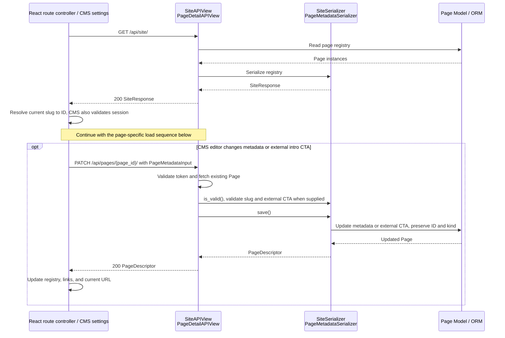

A successful slug change updates the registry and current navigation, but it does not create a redirect from the old URL. Preserving old external bookmarks would require a later alias model.

Image edits use the other shared sequence below. Whenever a page's editing diagram says “upload replacement image,” this is the work that happens before the content mutation attaches the returned asset.

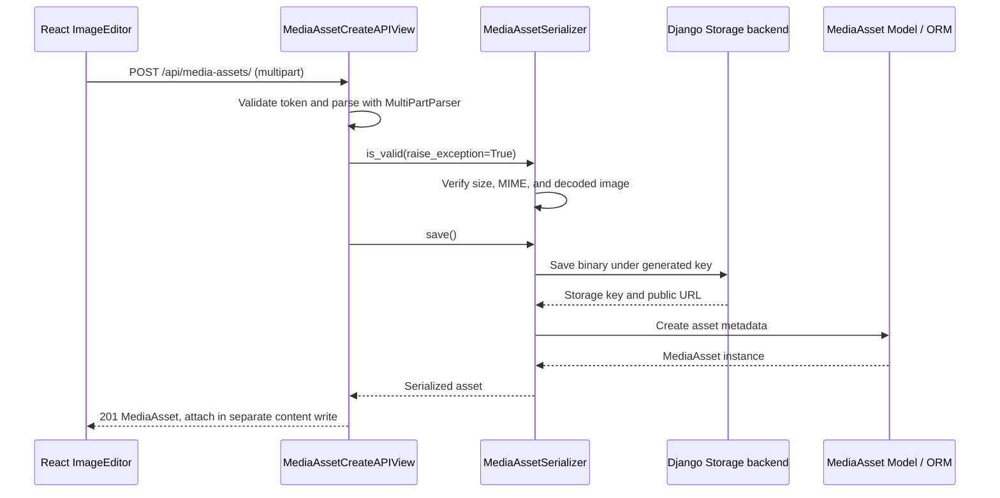

Before a page can load reliably, the database must contain the fixed records it expects. A versioned data migration using historical models seeds page identities and external CTA defaults, standalone image slots, Music's feature, and initial copy. Freeze keys and defaults with the migration, and create only missing records so initialization cannot overwrite CMS edits. Later text blocks and collection entries need no seed migration. The shared footer retains the designed copyright and credit presentation.

We can now apply these pieces to the visible pages. Home introduces the basic load/edit cycle; Voiceover adds a promotable collection and selected detail; the remaining pages show where those patterns repeat and where a separate content shape is needed.

## Home Page

Designs: [desktop](https://www.figma.com/design/viiamFWKh3yqWHBfl1PJA3/Elspeth-Eastman-Redesign?node-id=244-425) · [mobile](https://www.figma.com/design/viiamFWKh3yqWHBfl1PJA3/Elspeth-Eastman-Redesign?node-id=8-204) · [CMS desktop](https://www.figma.com/design/viiamFWKh3yqWHBfl1PJA3/Elspeth-Eastman-Redesign?node-id=346-10828) · [CMS mobile](https://www.figma.com/design/viiamFWKh3yqWHBfl1PJA3/Elspeth-Eastman-Redesign?node-id=346-10859).

Home introduces Elspeth and gives the visitor a way to get in touch. It is also the simplest place to establish the shared page architecture: `HomePage` composes `HomeHero` and the retained `ContactForm`, without a trivia strip or a promotable collection.

The hero draws its introduction from `intro` copy blocks, identity labels, and the seeded `hero` image slot in `PageContent`. The number of headlines, subheadlines, and body blocks follows the data. Desktop places image and copy side by side; mobile places the name over the image and contact below the copy. Those are responsive arrangements of the same content, so the CMS edits one set of records for both.

The Home API follows that small set of responsibilities. `GET /api/pages/{page_id}/` returns `HomePageResponse` for rendering. Hero text uses `POST /api/copy/` (`CopyWrite`), `PATCH /api/copy/` (`CopyPatch`), and `DELETE /api/copy/?page_id={page_id}&key={key}`. Identity labels use `/api/eyebrows/` and `/api/eyebrows/{id}/` with the shared methods, and `PATCH /api/page-images/` accepts `PageImageWrite` to replace the hero image. Copy and labels share `PATCH /api/collections/reorder/`.

Contact is a different interaction: the visitor submits a message rather than editing page content. It therefore retains the existing public `POST /api/contact-me/` endpoint.

The contracts keep those two interactions separate. `HomeHero` receives content and uses the shared CMS editors; `ContactForm` receives a submission callback with the existing contact request and response shapes.

```ts
/** Home aggregate; all editable hero content is in the shared collections. */
interface HomePageResponse extends PageContent {}

/** Hero presentation; editing callbacks come from CMSContext and the shared editors. */
interface HomeHeroProps {
  /** Current site identity displayed in the hero. */
  page: PageDescriptor;
  /** Ordered intro blocks rendered by semantic kind. */
  blocks: CopyBlock[];
  /** Seeded hero slot containing its resolved asset and alt text. */
  image: PageImage;
  /** Ordered identity labels. */
  eyebrows: Eyebrow[];
}

/** Public contact form submission accepted by the existing ContactSerializer. */
interface ContactInput {
  /** Sender name. */
  name: string;
  /** Sender email validated by DRF. */
  email: string;
  /** Message to persist and email. */
  message: string;
}

/** Existing success response after sending the contact email. */
interface ContactOutput {
  /** Existing literal response; do not replace it with the new content envelope. */
  message: "Success";
}

/** Controlled submit boundary around the existing contact form. */
interface ContactFormProps {
  /** Submit once, show serializer errors, and reset only after success. */
  onSubmit(input: ContactInput): Promise<ContactOutput>;
}

/** Shared public/CMS home composition. */
interface HomePageProps extends PageProps<HomePageResponse> {
  /** Passes the retained contact submission helper into ContactForm. */
  onContactSubmit(input: ContactInput): Promise<ContactOutput>;
}
```

On first load, the registry has already identified the Home page. One aggregate request supplies the hero; the contact form needs no separate CMS-content request. The sequence shows how the read moves through the page view, models, and serializer before React composes the result.

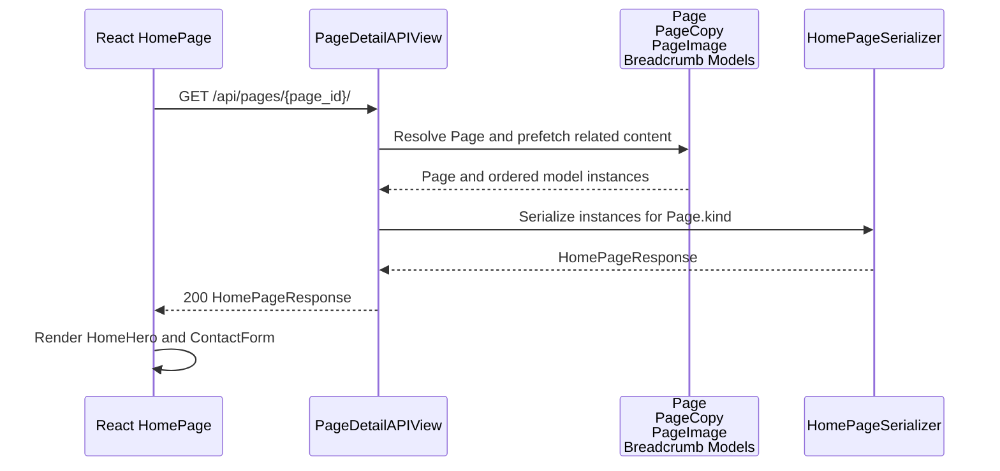

In CMS mode, an editor can change the introduction, identity labels, or image without changing that composition. Follow the relevant branch below to the shared save path. An image replacement first uses the upload sequence above; a text or label change goes directly to its content endpoint.

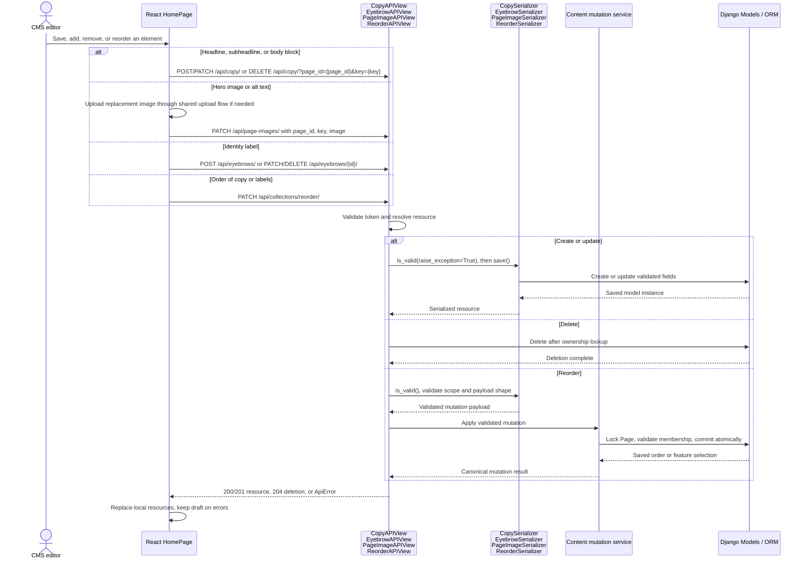

The contact path remains outside that editing sequence. `ContactViewSet.create()` validates `ContactSerializer`, saves a `Contact`, and calls `send_contact_email()`. A successful send updates `sent` and `date_sent` and returns `ContactOutput`. Preserve its existing failure behavior and tests as well as its public access: sending a message must not require a CMS token.

## Voiceover Page

Designs: [desktop](https://www.figma.com/design/viiamFWKh3yqWHBfl1PJA3/Elspeth-Eastman-Redesign?node-id=163-252) · [mobile](https://www.figma.com/design/viiamFWKh3yqWHBfl1PJA3/Elspeth-Eastman-Redesign?node-id=329-1310) · [selected desktop](https://www.figma.com/design/viiamFWKh3yqWHBfl1PJA3/Elspeth-Eastman-Redesign?node-id=244-499) · [selected mobile](https://www.figma.com/design/viiamFWKh3yqWHBfl1PJA3/Elspeth-Eastman-Redesign?node-id=329-1412) · [CMS desktop](https://www.figma.com/design/viiamFWKh3yqWHBfl1PJA3/Elspeth-Eastman-Redesign?node-id=414-3725) · [CMS mobile](https://www.figma.com/design/viiamFWKh3yqWHBfl1PJA3/Elspeth-Eastman-Redesign?node-id=414-3922).

Voiceover builds on the introduction pattern by giving visitors a collection of work to explore. `VoiceoverPage` combines `PageIntro`, a promoted `RoleHero`, `RoleGrid`, and `RoleDetail`. The linked base frames show the grid and selected detail; the hero adds the clarified promotion requirement to that presentation.

Each role is a `ContentEntry`. Its `eyebrow` is presented as Franchise, its `title` as Character, and its `description` as Summary. Featuring a role reuses that content and image in the hero. The CMS still shows the role in its list with a featured badge, so the editor always has a single record to maintain. Its optional detail heading and text live in the `details` metadata row and are edited in that same role form.

There are two different selections here. The editor chooses which role to feature for everyone; a visitor chooses which role to inspect. The visitor's selection sets `?role={id}` on the current route and opens `RoleDetail` from the already-loaded collection. Closing clears the parameter and restores the list; an invalid ID falls back to the list. Opening detail never changes the featured role.

The read contract reflects that distinction. `GET /api/pages/{page_id}/` returns `VoiceoverPageResponse`, with all roles in `roles` and the hero selection in `feature`. The introduction continues to use shared copy, eyebrow, and trivia endpoints. Its reel is the page-owned `primary_action`, edited by sending `PageMetadataInput` to `PATCH /api/pages/{page_id}/` and receiving `PageDescriptor`.

The collection endpoints below handle the roles themselves. They use the common `ContentEntry` contract, with Voiceover's field labels and validation rules.

| Full endpoint | Input | Success response |
| --- | --- | --- |
| `POST /api/content-entries/` | `ContentEntryInput` | `201 ContentEntry` |
| `PATCH /api/content-entries/{id}/` | `Partial<Omit<ContentEntryInput, "page_id">>` | `200 ContentEntry` |
| `DELETE /api/content-entries/{id}/` | None | `204`, no body |
| `PATCH /api/collections/reorder/` | `ReorderInput` with `collection: "content_entries"` | `200 ReorderOutput` |
| `PATCH /api/featured-items/` | `FeatureInput` with this page ID | `200 FeatureState` |

The component contracts separate collection editing, hero promotion, and visitor selection. `RoleGrid` exposes the collection callbacks; `RoleHero` opens the same role or its editor; `RoleDetail` only needs the loaded record and a way to close.

```ts
/** Aggregate role page including the canonical featured selection. */
interface VoiceoverPageResponse extends PageContent {
  /** Complete ordered collection, including the featured role. */
  roles: ContentEntry[];
  /** Current role hero selection or null item_id. */
  feature: FeatureState;
}

/** Shared page plus the URL-controlled role selection. */
interface VoiceoverPageProps extends PageProps<VoiceoverPageResponse> {
  /** Role ID parsed from the current route's query string. */
  selectedRoleId: number | null;
  /** Set or clear the role query parameter without another content request. */
  onRoleSelect(id: number | null): void;
}

/** Role cards with reusable CRUD/reorder callbacks and explicit promotion. */
interface RoleGridProps extends CollectionEditorProps<Omit<ContentEntryInput, "page_id">, ContentEntry> {
  /** Selection used for the featured badge and public-list filtering. */
  feature: FeatureState;
  /** Open RoleDetail for the chosen record. */
  onSelect(id: number): void;
  /** Promote this role, or demote the current hero when null. */
  onPromote(id: number | null): Promise<FeatureState>;
}

/** Featured role presentation; edits reuse RoleGrid callbacks. */
interface RoleHeroProps {
  /** Selected record from the complete role collection. */
  role: ContentEntry;
  /** Open the same record in RoleDetail. */
  onOpen(id: number): void;
  /** Open its role editor; no separate hero record is created. */
  onEdit(id: number): void;
}

/** Selected role view reused at desktop and mobile sizes. */
interface RoleDetailProps {
  /** Already-loaded selected record. */
  role: ContentEntry;
  /** Clear URL selection and return focus to its originating card. */
  onClose(): void;
}
```

The first-load sequence ends by interpreting the URL. Once the aggregate arrives, a valid role parameter opens detail immediately; otherwise the page derives the hero and remaining grid from the same collection. Neither branch needs another content request.

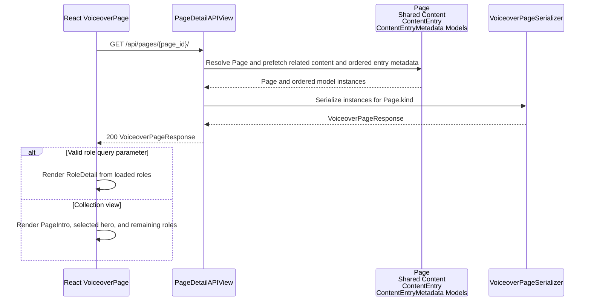

Editing a featured role follows the same save path as editing its grid card. Promotion is a separate branch because it changes the page's selection rather than the role's text or image. The final reconciliation must update both views of that record; deleting a role that is open in detail also returns the editor to the list.

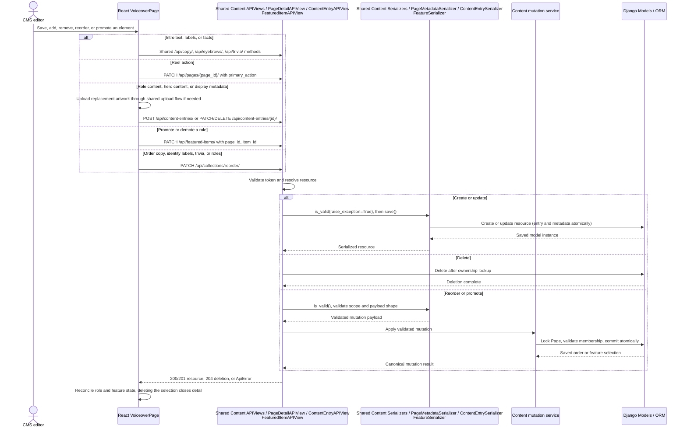

## Music Page

Designs: [desktop](https://www.figma.com/design/viiamFWKh3yqWHBfl1PJA3/Elspeth-Eastman-Redesign?node-id=244-699) · [mobile](https://www.figma.com/design/viiamFWKh3yqWHBfl1PJA3/Elspeth-Eastman-Redesign?node-id=345-5686) · [CMS desktop](https://www.figma.com/design/viiamFWKh3yqWHBfl1PJA3/Elspeth-Eastman-Redesign?node-id=414-4096) · [CMS mobile](https://www.figma.com/design/viiamFWKh3yqWHBfl1PJA3/Elspeth-Eastman-Redesign?node-id=346-11309).

Music uses the same introductory structure, but its main feature serves a different purpose from Voiceover's hero. The cello panel describes current practice, with practice facts and a watch action; the release list catalogs work. Promoting a release would not supply the same content, so `MusicPage` combines `PageIntro`, a dedicated `MusicFeature` singleton, and an independent `ReleaseList`.

Releases appear as horizontal cards on desktop and stacked cards on mobile. Their “Original music” heading remains an editable `section_label` copy block in `releases`, while the intro action's label and `#releases` destination stay in frontend code. Editors can change the content of those sections without changing the link between them.

One `GET /api/pages/{page_id}/` returns both sections in `MusicPageResponse`. Introduction, section labels, identity labels, and trivia use the shared endpoints. The table below adds two distinct editing contracts: patch the existing practice feature, or create, edit, delete, and reorder releases. Watch/listen actions belong to those records and remain editable; the internal jump to releases has no CMS mutation.

| Full endpoint | Input | Success response |
| --- | --- | --- |
| `PATCH /api/music-features/` | `MusicFeatureInput`, addressed by page ID | `200 MusicFeature` |
| `POST /api/music-releases/` | `MusicReleaseInput` | `201 MusicRelease` |
| `PATCH /api/music-releases/{id}/` | `Partial<Omit<MusicReleaseInput, "page_id">>` | `200 MusicRelease` |
| `DELETE /api/music-releases/{id}/` | None | `204`, no body |
| `PATCH /api/collections/reorder/` | `ReorderInput` with `collection: "releases"` | `200 ReorderOutput` |

The interfaces preserve that distinction. `MusicFeatureProps` saves the complete practice panel, including its facts, while `ReleaseListProps` inherits the standard collection callbacks. There is no promotion callback connecting the two.

```ts
/** Label/value pair embedded in the specialized feature editor. */
interface PracticeFact {
  /** Practice metadata label, for example Current study. */
  label: string;
  /** Displayed value, for example Popper · Etude No. 7. */
  value: string;
}

/** Complete update of the seeded music-practice singleton. */
interface MusicFeatureInput extends PageScope {
  /** Short practice status above the title. */
  eyebrow: string;
  /** Feature title, initially Cello. */
  title: string;
  /** Plain-text account of the current practice. */
  description: string;
  /** Feature portrait with contextual alt text. */
  image: ImageUseInput;
  /** Ordered practice facts replaced together; at most two in this layout. */
  facts: PracticeFact[];
  /** Watch-progress destination. */
  action: LinkInput;
}

/** Resolved specialized feature returned after reads and saves. */
interface MusicFeature extends Omit<MusicFeatureInput, "image" | "action"> {
  /** Expanded feature image. */
  image: ImageUse;
  /** Resolved watch-progress action. */
  action: LinkValue;
}

/** Editable release content, independent of the page title. */
interface MusicReleaseInput extends PageScope {
  /** Display year; an empty string omits it. */
  year: string;
  /** Release format, such as Album, Single, or Game soundtrack. */
  format: string;
  /** Release title. */
  title: string;
  /** Plain-text description or collaboration credit. */
  description: string;
  /** Required cover image and contextual alt text. */
  artwork: ImageUseInput;
  /** Optional text overlay; an empty string hides it. */
  artwork_title: string;
  /** Listen destination. */
  action: LinkInput;
}

/** Stored release with expanded artwork and action. */
interface MusicRelease extends Omit<MusicReleaseInput, "artwork" | "action">, OrderedRecord {
  /** Resolved cover image. */
  artwork: ImageUse;
  /** Resolved listen link. */
  action: LinkValue;
}

/** Music aggregate with a specialized feature and ordered releases. */
interface MusicPageResponse extends PageContent {
  /** Seeded practice singleton; missing setup is a 404, not an empty collection. */
  feature: MusicFeature;
  /** Complete manually ordered release collection. */
  releases: MusicRelease[];
}

/** Practice-card presentation and editor boundary. */
interface MusicFeatureProps {
  /** Current singleton data. */
  feature: MusicFeature;
  /** Save the whole feature after any image upload; replace the singleton response. */
  onSave(input: MusicFeatureInput): Promise<MusicFeature>;
}

/** Release-card CRUD and order using the shared collection contract. */
interface ReleaseListProps extends CollectionEditorProps<Omit<MusicReleaseInput, "page_id">, MusicRelease> {}

/** Shared page composed from PageIntro, MusicFeature, and ReleaseList. */
interface MusicPageProps extends PageProps<MusicPageResponse> {}
```

After route resolution, the aggregate read brings the practice singleton and releases into one render. The serializer supplies the specialized feature rather than deriving it from the release list; a missing seeded feature is a setup error, not an empty list state.

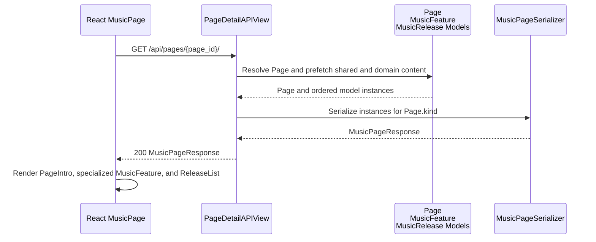

An editor first chooses whether they are updating the practice panel or a release. Both can upload replacement artwork, but they save to different owners: the singleton through `/api/music-features/`, a release through `/api/music-releases/`. Only the collections participate in reordering. The sequence keeps those choices separate before they enter the shared validation and save path.

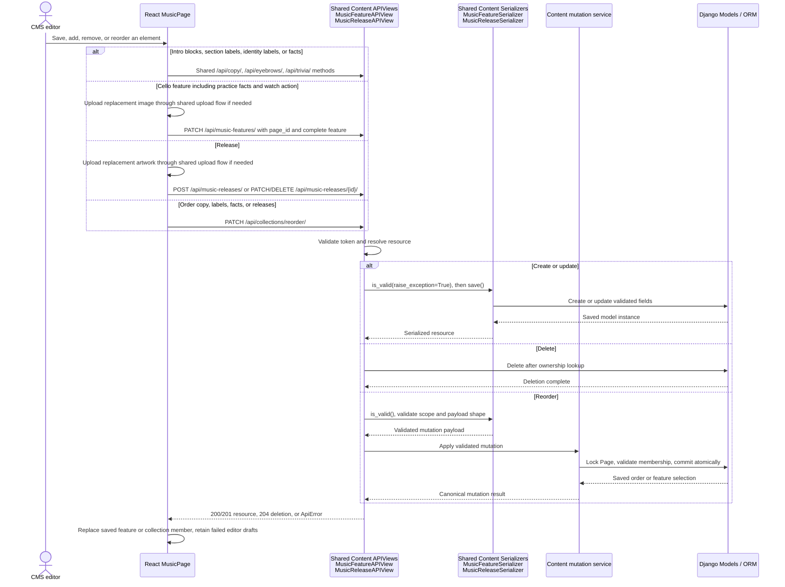

## Streaming Page

Designs: [desktop](https://www.figma.com/design/viiamFWKh3yqWHBfl1PJA3/Elspeth-Eastman-Redesign?node-id=244-923) · [mobile](https://www.figma.com/design/viiamFWKh3yqWHBfl1PJA3/Elspeth-Eastman-Redesign?node-id=345-5854) · [CMS desktop](https://www.figma.com/design/viiamFWKh3yqWHBfl1PJA3/Elspeth-Eastman-Redesign?node-id=346-11039) · [CMS mobile](https://www.figma.com/design/viiamFWKh3yqWHBfl1PJA3/Elspeth-Eastman-Redesign?node-id=346-10701).

Streaming returns to the promotable-entry pattern, with a second collection for clips. `StreamingPage` combines `PageIntro`, `StreamHero`, recent-stream cards, and clip cards. A recent stream is a `ContentEntry`; selecting it as the hero reuses its title, description, and image rather than creating a `StreamFeature` record. Visitors see the remaining streams below it, while the CMS retains the full list.

Clips are independent items with their own playback destinations. They can be edited and reordered, but they are not candidates for the recent-stream hero. That boundary lets the page present both kinds of media without making every card behave the same way.

The aggregate `GET /api/pages/{page_id}/` makes that boundary visible in `StreamingPageResponse`: `entries` contains the page's `ContentEntry` records, `clips` contains its clip records, and `feature` identifies the selected stream. Intro and section copy, identity labels, and trivia use the shared endpoints. The Twitch action belongs to `page.primary_action`; editing it uses `PATCH /api/pages/{page_id}/` with `PageMetadataInput` and returns `PageDescriptor`.

The write endpoints below preserve the same separation between recent streams and clips.

| Full endpoint | Input | Success response |
| --- | --- | --- |
| `POST /api/content-entries/` | `ContentEntryInput` | `201 ContentEntry` |
| `PATCH /api/content-entries/{id}/` | `Partial<Omit<ContentEntryInput, "page_id">>` | `200 ContentEntry` |
| `DELETE /api/content-entries/{id}/` | None | `204`, no body |
| `POST /api/stream-clips/` | `StreamClipInput` | `201 StreamClip` |
| `PATCH /api/stream-clips/{id}/` | `Partial<Omit<StreamClipInput, "page_id">>` | `200 StreamClip` |
| `DELETE /api/stream-clips/{id}/` | None | `204`, no body |
| `PATCH /api/collections/reorder/` | `ReorderInput` with `content_entries` or `stream_clips` | `200 ReorderOutput` |
| `PATCH /api/featured-items/` | `FeatureInput` with this page ID | `200 FeatureState` |

The props give `StreamList` collection editing and promotion, while `ClipList` receives collection editing only. `StreamHero` opens the source stream's editor. An entry may lack an image in the list, so the promotion callback must surface the missing-image error before it can become the hero.

```ts
/** Clip card fields; clips are not eligible for the recent-stream hero. */
interface StreamClipInput extends PageScope {
  /** Game, collaboration, or other short context above the title. */
  eyebrow: string;
  /** Clip title. */
  title: string;
  /** Card metadata such as Highlights or Roleplay. */
  category: string;
  /** External playback destination. */
  action: LinkInput;
}

/** Stored clip with its resolved playback destination. */
interface StreamClip extends Omit<StreamClipInput, "action">, OrderedRecord {
  /** Resolved outbound clip destination. */
  action: LinkValue;
}

/** Aggregate for the stream hero, recent entries, and clips. */
interface StreamingPageResponse extends PageContent {
  /** Complete ordered stream collection, including the featured entry. */
  entries: ContentEntry[];
  /** Independent ordered clip collection. */
  clips: StreamClip[];
  /** Selected recent-stream ID or null. */
  feature: FeatureState;
}

/** Recent-stream CRUD, ordering, and promotion. */
interface StreamListProps extends CollectionEditorProps<Omit<ContentEntryInput, "page_id">, ContentEntry> {
  /** Selection for the badge and public-list filtering. */
  feature: FeatureState;
  /** Select the hero or clear it; surfaces missing-image validation. */
  onPromote(id: number | null): Promise<FeatureState>;
}

/** Featured stream presentation that edits its source entry. */
interface StreamHeroProps {
  /** Selected stream with a validated non-null image. */
  entry: ContentEntry;
  /** Open the existing stream-entry editor from the hero. */
  onEdit(id: number): void;
}

/** Clip cards using shared collection callbacks. */
interface ClipListProps extends CollectionEditorProps<Omit<StreamClipInput, "page_id">, StreamClip> {}

/** Shared composition of PageIntro, StreamHero, stream cards, and clips. */
interface StreamingPageProps extends PageProps<StreamingPageResponse> {}
```

The page loads streams and clips together, then uses `feature.item_id` to choose the hero from the returned entries. Hero selection is therefore a rendering step after the aggregate arrives, not a separate fetch or a separate source of stream content.

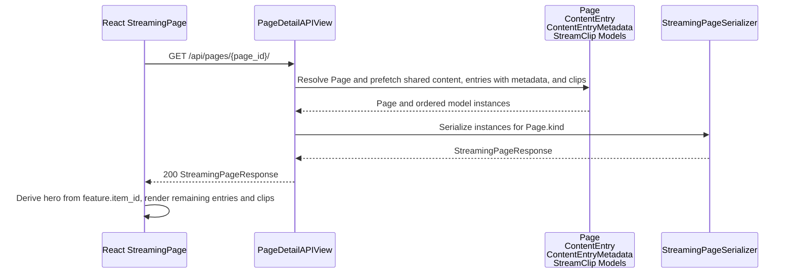

The important choice in this sequence is the owner of the edit. Twitch settings belong to the page, stream and hero content belong to a `ContentEntry`, and clip content belongs to a `StreamClip`. Promotion adds the image-eligibility check; after a successful write, the client reconciles the affected collection and hero selection without reloading the page.

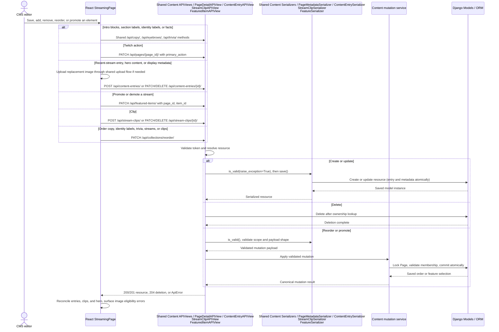

## Press Page

Designs: [desktop](https://www.figma.com/design/viiamFWKh3yqWHBfl1PJA3/Elspeth-Eastman-Redesign?node-id=244-1115) · [mobile](https://www.figma.com/design/viiamFWKh3yqWHBfl1PJA3/Elspeth-Eastman-Redesign?node-id=343-1624) · [selected desktop](https://www.figma.com/design/viiamFWKh3yqWHBfl1PJA3/Elspeth-Eastman-Redesign?node-id=244-1378) · [selected mobile](https://www.figma.com/design/viiamFWKh3yqWHBfl1PJA3/Elspeth-Eastman-Redesign?node-id=343-1798) · [CMS desktop](https://www.figma.com/design/viiamFWKh3yqWHBfl1PJA3/Elspeth-Eastman-Redesign?node-id=346-11079) · [CMS mobile](https://www.figma.com/design/viiamFWKh3yqWHBfl1PJA3/Elspeth-Eastman-Redesign?node-id=346-11254).

Press combines two patterns already established: Voiceover's selected-detail view and Streaming's separation between a promotable collection and a second, independent list. `PressPage` composes `PageIntro`, `PressHero`, `PressCoverage`, `AppearanceList`, and `PressDetail`. Coverage entries can become the hero; appearances remain rows in their own collection and cannot be promoted.

The CMS's featured control selects an existing coverage record, so editing its card or hero changes the same entry. Its publication/channel comes from the required `outlet` metadata row, whose label and value are edited with the coverage record. The headings for coverage and appearances remain shared `section_label` copy blocks in their respective `coverage` and `appearances` sections.

As on Voiceover, a visitor's selected detail is independent of the editor's hero selection. Opening a press card sets `?entry={id}` and reads the matching entry from the aggregate. Closing clears the parameter and restores focus to the source card. An invalid selection falls back to coverage rather than triggering another lookup.

The aggregate `GET /api/pages/{page_id}/` returns `PressPageResponse`, keeping `entries`, `appearances`, and `feature` distinct. Shared endpoints handle intro and section copy, identity labels, and trivia. Any external intro CTA belongs to `page.primary_action` and uses `PATCH /api/pages/{page_id}/` (`PageMetadataInput` → `PageDescriptor`); intra-site actions remain code-defined.

Coverage uses the common entry endpoints in the table below. Appearance rows have their own input shape and CRUD endpoints because they do not need the artwork, detail, or promotion behavior of coverage.

| Full endpoint | Input | Success response |
| --- | --- | --- |
| `POST /api/content-entries/` | `ContentEntryInput` | `201 ContentEntry` |
| `PATCH /api/content-entries/{id}/` | `Partial<Omit<ContentEntryInput, "page_id">>` | `200 ContentEntry` |
| `DELETE /api/content-entries/{id}/` | None | `204`, no body |
| `POST /api/appearances/` | `AppearanceInput` | `201 Appearance` |
| `PATCH /api/appearances/{id}/` | `Partial<Omit<AppearanceInput, "page_id">>` | `200 Appearance` |
| `DELETE /api/appearances/{id}/` | None | `204`, no body |
| `PATCH /api/collections/reorder/` | `ReorderInput` with `content_entries` or `appearances` | `200 ReorderOutput` |
| `PATCH /api/featured-items/` | `FeatureInput` with this page ID | `200 FeatureState` |

The props follow those two experiences. `PressCoverage` handles editing, selection, and promotion; `PressHero` and `PressDetail` receive the selected coverage record. `AppearanceList` only needs the shared collection callbacks for its simpler rows.

```ts
/** Editable row in the independent appearances table. */
interface AppearanceInput extends PageScope {
  /** Displayed event year. */
  year: string;
  /** Event or appearance title. */
  title: string;
  /** Format label, for example Panel or Podcast. */
  format: string;
  /** Optional HTTP(S) source; null renders a non-linked row. */
  url: string | null;
}

/** Persisted appearance in manual order. */
interface Appearance extends AppearanceInput, OrderedRecord {}

/** Aggregate press page including the full collection and hero selection. */
interface PressPageResponse extends PageContent {
  /** Complete ordered coverage collection, including the promoted entry. */
  entries: ContentEntry[];
  /** Ordered appearance rows. */
  appearances: Appearance[];
  /** Selected press entry or null. */
  feature: FeatureState;
}

/** Shared press composition with URL-controlled detail selection. */
interface PressPageProps extends PageProps<PressPageResponse> {
  /** Entry ID parsed from the query string. */
  selectedEntryId: number | null;
  /** Set or clear selection without another data request. */
  onEntrySelect(id: number | null): void;
}

/** Press-card CRUD, ordering, selection, and hero promotion. */
interface PressCoverageProps extends CollectionEditorProps<Omit<ContentEntryInput, "page_id">, ContentEntry> {
  /** Selection used for the featured badge and public-list filtering. */
  feature: FeatureState;
  /** Open the record in PressDetail. */
  onSelect(id: number): void;
  /** Select an existing press entry as hero or clear the hero. */
  onPromote(id: number | null): Promise<FeatureState>;
}

/** Featured press entry backed by the coverage collection. */
interface PressHeroProps {
  /** Promoted record from the loaded entries. */
  entry: ContentEntry;
  /** Open detail for the promoted entry. */
  onOpen(id: number): void;
  /** Open its existing press editor. */
  onEdit(id: number): void;
}

/** Appearance rows using the shared collection editing contract. */
interface AppearanceListProps extends CollectionEditorProps<Omit<AppearanceInput, "page_id">, Appearance> {}

/** Selected article presentation at both viewport sizes. */
interface PressDetailProps {
  /** Selected, already-loaded press record. */
  entry: ContentEntry;
  /** Clear selection and return focus to the source card. */
  onClose(): void;
}
```

Once the aggregate is available, the URL determines whether the visitor starts in coverage or in a selected article's detail. Both paths use the same loaded entries. The appearances and featured selection arrive with them, so returning to coverage does not require rebuilding the page's data.

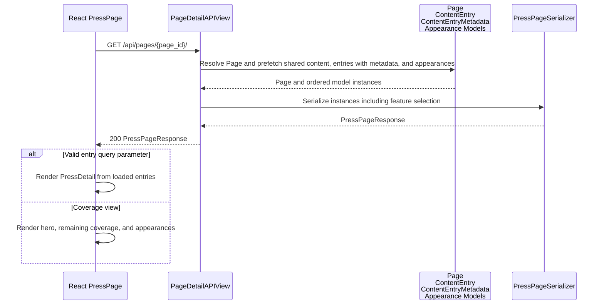

A press edit follows the same path whether it begins on a card or the hero. Changing the featured selection is a separate operation, and appearance edits never enter that promotion path. When the selected detail record is deleted, the final state update must also close detail and return to coverage.


## Bio Page

Designs: [desktop](https://www.figma.com/design/viiamFWKh3yqWHBfl1PJA3/Elspeth-Eastman-Redesign?node-id=244-1672) · [mobile](https://www.figma.com/design/viiamFWKh3yqWHBfl1PJA3/Elspeth-Eastman-Redesign?node-id=345-5983) · [CMS desktop](https://www.figma.com/design/viiamFWKh3yqWHBfl1PJA3/Elspeth-Eastman-Redesign?node-id=346-11163) · [CMS mobile](https://www.figma.com/design/viiamFWKh3yqWHBfl1PJA3/Elspeth-Eastman-Redesign?node-id=346-10629).

Bio uses the shared content primitives to tell a longer story. `BioPage` begins with `PageIntro` and a portrait-led `BioFeature`, then continues through `BioStory`, `CurrentWork`, and `ExploreLinks`. Unlike the collection heroes, the short biography is authored introductory content: its `short_bio` copy blocks and seeded `portrait` slot are edited directly.

Below that introduction, chapters keep related headings and narrative together, while current-work cards describe individual activities. Both collections can be reordered without changing the opening biography. Their section headings use the `story`, `current`, and `explore` copy regions.

The page ends by inviting visitors into the rest of the site. `ExploreLinks` uses the code-defined destinations `voiceover`, `music`, `streaming`, and `press` in that order, resolving current labels and URLs through the page registry and shared route helper. There is no link collection or create/edit/delete/reorder UI. Desktop places the introduction beside the content column; mobile reads the same components in document order.

The aggregate `GET /api/pages/{page_id}/` returns `BioPageResponse`. Introductory text, the short biography, and section headings continue to use `POST /api/copy/`, `PATCH /api/copy/`, and keyed DELETE. Portrait edits use `PATCH /api/page-images/` with `PageImageWrite`; identity labels and trivia use their shared collection endpoints.

Only chapters and current-work cards need additional endpoints, listed below. Keeping those grouped records separate from the introductory copy gives editors a meaningful unit to move or delete: a chapter or activity, rather than its individual fields.

| Full endpoint | Input | Success response |
| --- | --- | --- |
| `POST /api/bio-chapters/` | `BioChapterInput` | `201 BioChapter` |
| `PATCH /api/bio-chapters/{id}/` | `Partial<Omit<BioChapterInput, "page_id">>` | `200 BioChapter` |
| `DELETE /api/bio-chapters/{id}/` | None | `204`, no body |
| `POST /api/current-items/` | `CurrentItemInput` | `201 CurrentItem` |
| `PATCH /api/current-items/{id}/` | `Partial<Omit<CurrentItemInput, "page_id">>` | `200 CurrentItem` |
| `DELETE /api/current-items/{id}/` | None | `204`, no body |
| `PATCH /api/collections/reorder/` | `ReorderInput` with `bio_chapters` or `current_items` | `200 ReorderOutput` |

The contracts mirror the reading order. `BioFeature` uses the shared image and copy editors; `BioStory` and `CurrentWork` inherit collection editing; `ExploreLinks` only receives the registry needed to render navigation.

```ts
/** A chapter in the manually ordered biography story. */
interface BioChapterInput extends PageScope {
  /** Milestone label such as Early years or The turn. */
  eyebrow: string;
  /** Visible chapter heading. */
  heading: string;
  /** Plain-text chapter narrative. */
  body: string;
}

/** Stored biography chapter with manual position. */
interface BioChapter extends BioChapterInput, OrderedRecord {}

/** Current-work card content. */
interface CurrentItemInput extends PageScope {
  /** Discipline label above the title. */
  eyebrow: string;
  /** Name of the current activity. */
  title: string;
  /** Short plain-text description. */
  description: string;
  /** Optional destination; null renders a non-linked card. */
  link: LinkInput | null;
}

/** Persisted current-work card with resolved optional destination. */
interface CurrentItem extends Omit<CurrentItemInput, "link">, OrderedRecord {
  /** Expanded link, or null when no action is offered. */
  link: LinkValue | null;
}

/** Bio aggregate; portrait and short-bio copy use shared collections, while explore links are code-defined. */
interface BioPageResponse extends PageContent {
  /** Story chapters in manual order. */
  chapters: BioChapter[];
  /** Current-work cards in manual order. */
  current_items: CurrentItem[];
}

/** Portrait and short biography with shared image/copy editors from CMSContext. */
interface BioFeatureProps {
  /** Seeded portrait slot. */
  portrait: PageImage;
  /** Ordered short_bio blocks; render by kind instead of fixed content keys. */
  blocks: CopyBlock[];
}

/** Chapter rendering with the shared collection CRUD and order callbacks. */
interface BioStoryProps extends CollectionEditorProps<Omit<BioChapterInput, "page_id">, BioChapter> {}

/** Current-work rendering with the shared collection editing callbacks. */
interface CurrentWorkProps extends CollectionEditorProps<Omit<CurrentItemInput, "page_id">, CurrentItem> {}

/** Code-defined explore navigation with no CMS mutation callbacks. */
interface ExploreLinksProps {
  /** Current registry used to resolve internal destinations in public or CMS mode. */
  pages: PageDescriptor[];
}

/** Shared composition of introduction, biography, story, current work, and links. */
interface BioPageProps extends PageProps<BioPageResponse> {}
```

The server loads the portrait, copy, chapters, and current-work cards as one aggregate. React then composes the biography and adds the code-defined explore destinations from the registry. The navigation needs no additional content query.

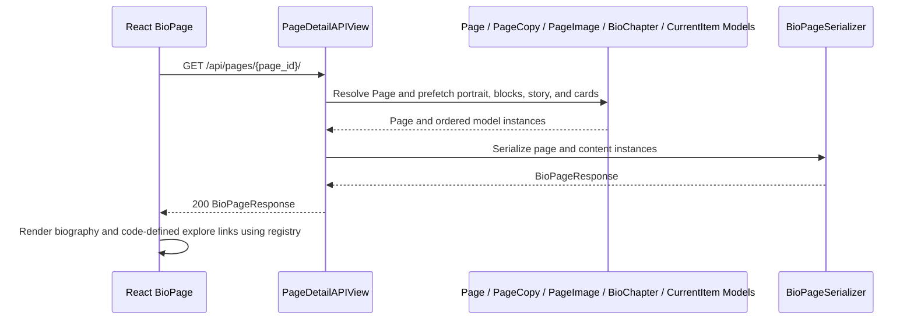

Editing stays attached to the content unit the reader sees. A short-biography paragraph uses the copy editor, a portrait replacement uses the upload-and-attach flow, and a chapter or current-work card saves through its own collection endpoint. The explore links deliberately have no editing branch because they belong to frontend navigation, not CMS-managed content.

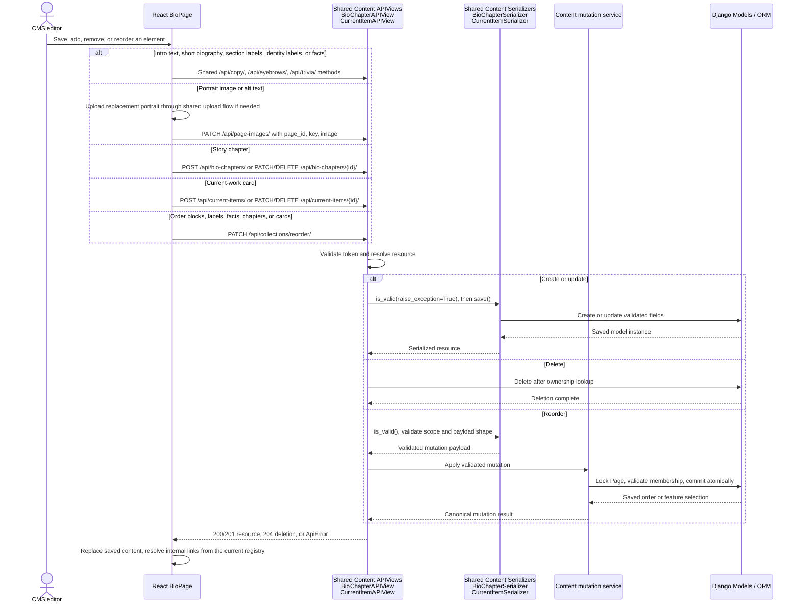

## Delivery and Verification

The page walkthroughs also define an implementation order. First establish the shared request and editing path, then prove it on Home before adding collection behavior. Each subsequent page should arrive as a working public/CMS pair, with its data model, API, controls, and tests delivered together:

1. Establish page lookup and editing with the registry, media storage, shared records, aggregate views, mutation helpers, `CMSContext`, and editor primitives.
2. Use Home to prove the complete load/edit cycle while preserving the existing contact pipeline.
3. Extend that foundation through Voiceover, Music, Streaming, Press, and Bio in order. Complete the models, migrations, serializers, endpoints, public/CMS rendering, and tests for each page before treating it as delivered.
4. Populate the completed structures with approved content, migrating legacy records only where the target is unambiguous.
5. Once no redesigned route reads the old content, remove `/projects` and retire the legacy rendering and endpoints.

Completion means more than matching a screenshot. A visitor must be able to load and navigate the page, and an editor must be able to change it without losing work or violating its content rules. Use the following checks as the acceptance gate for each page:

- its public and CMS routes mount the same page component;
- the aggregate GET renders the approved desktop and mobile structures;
- every callback in the page's component contracts is wired to the documented endpoint;
- successful mutations replace local state without a full-page refetch;
- `400` errors stay in the editor, `403` uses the global expired-session path, and network failures use the existing toast path;
- media uploads reject invalid type, unreadable files, and oversize files;
- image associations reject missing alt text;
- reorder tests cover duplicates, missing IDs, cross-collection IDs, atomic rollback, and final order;
- page renames preserve resource IDs, resolve code-defined internal destinations, and keep CMS navigation under its prefix;
- intra-site navigation exposes no link CRUD/reorder controls, while external CTA edits persist on the owning page or domain record;
- adding/removing/reordering intro or short-bio blocks requires no API or schema changes;
- shared entry tests cover page-kind validation, rejected ownership/type changes, metadata rules, ISO 8601 publication timestamp validation and UTC round-tripping, and PATCH validation against the merged record;
- metadata tests cover unique keys per entry, required Press outlet, omitted versus empty replacement arrays, preserved row IDs, array ordering, rejected client-supplied row IDs/ownership, atomic rollback, and cascade deletion;
- ordering and promotion reject entries from another page even though all three pages use the same table;
- promotion tests cover switching, demotion, deleting the hero, concurrent promotions, and rejecting missing hero imagery, including concurrent image removal;
- Music's feature stays independent of releases;
- selected Voiceover and Press URLs restore the selected state on reload; and
- backend tests prove anonymous GET, token-protected writes, fixed-slot seeding, singleton behavior, collection CRUD, and contact-email preservation.

The final cutover connects the existing site's data to those tested page structures. A legacy category can suggest a destination, but it does not prove that every field has a sound counterpart. Use the mappings below only where the approved content and field mapping agree:

| Legacy source | Redesign target |
| --- | --- |
| `Skills.voice_acting` | Voiceover intro copy when approved |
| `Skills.streaming` | Streaming intro copy when approved |
| `Experience.VOICE_CREDITS` | `ContentEntry` owned by the Voiceover page, with a verified field mapping |
| `Experience.MUSIC_GAMES` and `Experience.MUSIC_MISCELLANEOUS` | Music releases with a verified field mapping |
| `Experience.STREAMING_CREDITS` | `ContentEntry` owned by the Streaming page when the record represents a stream |
| `Project` | Streaming clips only when source and title are sufficient |
| `Affiliations` | No automatic target; the approved footer has no editable link list |
| `FooterStat` | Retire |

Archive ambiguous legacy data rather than guessing it into the new structure. The cutover is complete when the redesigned routes both display and edit their new records, while the retained contact and authentication paths still work. That closes the loop established at the start: visitors and editors use the same pages, backed by content whose identity and ownership remain clear as the site changes.
